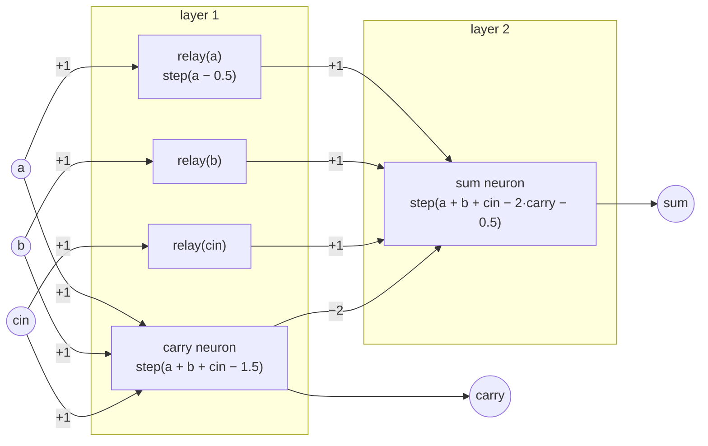

# Programmable Neural Networks

**Program the network instead of training it.**

`pnn` is a small, NumPy-only proof of concept for one idea: a neural network's
weights do not have to be *learned*. When you already know the computation,
you can **compile** it straight into weights, the way a compiler turns source
code into machine code. You get no training data, no gradient descent and no
"99.4% accurate". The network is correct by construction.

The flagship demo is a **binary calculator that runs entirely as a feed-forward
neural network**: N-bit addition, subtraction, multiplication and comparison.
Every answer comes from `x ← step(W x + b)`, applied layer by layer with dense
NumPy weight matrices. Nobody trained those weights. A compiler of a few hundred lines
derived them from logic.

```text
$ python -m pnn.calc 13 + 29 --bits 8
pnn: 13 + 29   [8-bit ripple-carry adder, step activation]
  a      =     13   0b00001101
  b      =     29   0b00011101
  result =     42   0b00101010   carry=0
  check  : OK (verified against Python integers)
network: 16 inputs -> 9 outputs | 9 layers | 124 neurons (16 logic + 108 relay)
         1,976 params (286 non-zero) | max |w| = 2 | trained: never
```

The test suite checks the networks **exhaustively** against Python integers:
all 65,536 8-bit sums, differences, products and comparisons. It also checks
every 4- and 6-bit product and every gate's truth table, in about a second on a laptop CPU.

> **Honest framing.** This is a proof of concept and a teaching tool, not a new
> theory. Threshold neurons computing logic go back to **McCulloch & Pitts
> (1943)**, and threshold-logic circuits (including shallow threshold adders
> and comparators) were studied extensively from the 1960s onward. More recently,
> **RASP** (Weiss et al., 2021) and **Tracr** (Lindner et al., 2023) compile
> programs into transformer weights. `pnn` puts the idea into a small, readable,
> fully tested package, and it points at where we want to take it: networks that
> are partly *programmed* and partly *trained*.

---

## Quickstart

```bash
git clone https://github.com/bystac/programmable-neural-networks.git
cd programmable-neural-networks
pip install -e ".[dev]"      # only dependency: numpy (pytest for dev)
pytest                       # exhaustive tests, ~1-2 s

python -m pnn.calc 13 + 29 --bits 8
python -m pnn.calc 200 - 57
python -m pnn.calc 12 '*' 13            # quote * and < so the shell leaves them alone
python -m pnn.calc 7 '<' 9
python -m pnn.calc 42 == 42
python -m pnn.calc 13 + 29 --style lookahead --mode sigmoid
python -m pnn.calc 13 + 29 --export adder8.npz   # or .json
```

Options: `--bits N` (operand width), `--style ripple|lookahead`,
`--mode step|sigmoid` (and `--steepness`), and `--export PATH`. `x`, `lt` and `eq` are
accepted as aliases for `*`, `<` and `==`.

### Sample output (real, captured from this repo)

```text
$ python -m pnn.calc 200 - 57 --bits 8
pnn: 200 - 57   [8-bit two's-complement ripple subtractor, step activation]
  a      =    200   0b11001000
  b      =     57   0b00111001
  result =    143   0b10001111   borrow=0
  check  : OK (verified against Python integers)
network: 16 inputs -> 9 outputs | 9 layers | 124 neurons (17 logic + 107 relay)
         1,976 params (286 non-zero) | max |w| = 2 | trained: never

$ python -m pnn.calc 12 '*' 13 --bits 8
pnn: 12 * 13   [8-bit shift-and-add array multiplier (ripple rows), step activation]
  a      =     12   0b00001100
  b      =     13   0b00001101
  result =    156   0b0000000010011100
  check  : OK (verified against Python integers)
network: 16 inputs -> 16 outputs | 28 layers | 1230 neurons (176 logic + 1054 relay)
         61,744 params (2,788 non-zero) | max |w| = 2 | trained: never

$ python -m pnn.calc 13 + 29 --style lookahead --mode sigmoid
pnn: 13 + 29   [8-bit threshold carry-lookahead adder, sigmoid activation]
  a      =     13   0b00001101
  b      =     29   0b00011101
  result =     42   0b00101010   carry=0
  check  : OK (verified against Python integers)
network: 16 inputs -> 9 outputs | 2 layers | 33 neurons (16 logic + 17 relay)
         633 params (153 non-zero) | max |w| = 128 | trained: never

$ python -m pnn.calc 7 '<' 9 --style lookahead
pnn: 7 < 9   [8-bit comparator (one weighted neuron), step activation]
  a      =      7   0b00000111
  b      =      9   0b00001001
  result =   true   (1)
  check  : OK (verified against Python integers)
network: 16 inputs -> 1 output | 1 layers | 1 neurons (1 logic + 0 relay)
         17 params (17 non-zero) | max |w| = 128 | trained: never
```

### Network sizes (8-bit operands)

| Operation | Style | Layers | Neurons (logic + relay) | Params (non-zero) | max \|w\| |
|---|---|---:|---:|---:|---:|
| `a + b` | ripple | 9 | 124 (16 + 108) | 1,976 (286) | 2 |
| `a + b` | lookahead | 2 | 33 (16 + 17) | 633 (153) | 128 |
| `a - b` | ripple | 9 | 124 (17 + 107) | 1,976 (286) | 2 |
| `a * b` | ripple | 28 | 1,230 (176 + 1,054) | 61,744 (2,788) | 2 |
| `a * b` | lookahead | 15 | 686 (176 + 510) | 33,743 (2,043) | 128 |
| `a < b` | lookahead | 1 | 1 | 17 (17) | 128 |

"Params" counts every entry of the dense weight matrices plus biases, the way
a standard MLP is counted. Most of them are zero, because circuits are sparse.

---

## The neuron

Every neuron in `pnn` is a classic threshold unit:

```text
y = step(w · x + b)        step(z) = 1 if z > 0 else 0
```

The compiler only emits **integer weights and half-integer biases** (…, −1.5,
−0.5, 0.5, 1.5, …), so on binary inputs `w · x + b` is never closer than 0.5 to the
threshold. That margin lets you swap `step` for a steep sigmoid
`σ(k·z)` (`--mode sigmoid`, default `k = 20`). The network becomes smooth and
differentiable, and it still gives the exact answer after rounding. The tests
check this exhaustively for 8-bit addition.

| Gate | Weights | Bias | Neurons |
|---|---|---:|---:|
| `NOT x` | −1 | +0.5 | 1 |
| `AND(x1..xn)` | 1 … 1 | −(n − 0.5) | 1 |
| `OR(x1..xn)` | 1 … 1 | −0.5 | 1 |
| `NAND`, `NOR` | −1 … −1 | n − 0.5, +0.5 | 1 |
| `MAJ(x, y, z)` | 1, 1, 1 | −1.5 | 1 |
| `XOR(x, y)` | `c = AND(x,y)`, then `x + y − 2c` | −0.5 | 2 |
| full adder | `carry = MAJ(a,b,cin)`, `sum = a + b + cin − 2·carry` | −0.5 | 2 |

XOR is not linearly separable (Minsky & Papert's classic objection), so it takes
two neurons, and the second one reads both the inputs *and* the first neuron.
That is a skip connection, which is where relay neurons come in.

### A full adder as two neurons



Chain eight of these and you have the 8-bit ripple-carry adder in the first sample output.

---

## How the compiler works

```text
gate expressions / circuit builders
        │   peephole optimisation while building
        ▼
Circuit: a DAG of threshold gates  (pnn.circuit)
        │   prune → schedule into layers → insert relays → emit matrices
        ▼
Network: [(W1, b1), (W2, b2), …]   (pnn.network)   → .npz / .json
```

1. **Build** a `Circuit`. You can use the gate helpers (`c.and_`, `c.xor`,
   `c.full_adder`, …), operator overloading (`(a & b) | ~c`), the expression
   compiler, or raw `c.threshold(inputs, weights, bias)`. While the DAG is built,
   the circuit runs cheap peephole optimisations:
   * **constant folding**: a constant input is absorbed into the bias. This is
     how `a − b = a + ~b + 1` costs no more than `a + b`.
   * **NOT folding**: `w·NOT(x)` becomes `w − w·x`, so negations usually cost
     zero neurons.
   * **identity removal**: `step(x − 0.5)` is just `x`.
   * **constant detection**: a gate whose output cannot change becomes a
     constant. This is why the multiplier's all-zero columns are free.
   * **hash-consing**: structurally identical gates are created only once.
2. **Prune**: keep only gates reachable from the requested outputs.
3. **Schedule**: ASAP levelisation, `layer(g) = 1 + max(layer(inputs))`.
4. **Relay**: a strictly layered MLP can only read the previous layer. A value
   that is needed further ahead (a skip connection) is carried forward by
   identity neurons `step(x − 0.5)`. The stats report these separately as
   *relay* neurons. In the ripple adder they are most of the neurons, which
   shows the cost of depth.
5. **Emit**: each gate's weights and bias become one row of that layer's dense
   weight matrix. `Network.save_npz` / `save_json` export everything, including
   neuron labels.

### Compile your own logic

```python
from pnn import compile_expression, compile_program

net = compile_expression("(a & b) | ~c")
net.forward([1, 1, 0])            # -> array([1.])
print(net.summary())
# 3 inputs -> 1 outputs | 2 layers | 3 neurons (2 logic + 1 relay) | 11 params (8 non-zero) | max |w| = 1
for layer in net.layers:
    print(layer.W, layer.b)
# [[1. 1. 0.]      [-1.5 -0.5]     <- AND(a, b) and relay(c)
#  [0. 0. 1.]]
# [[ 1. -1.]]      [0.5]           <- OR(and, NOT c), NOT folded into the weights

adder = compile_program("""
_p    = a ^ b
sum   = _p ^ cin
carry = MAJ(a, b, cin)
""")
```

Supported syntax: `& | ^ ~`, `and or not`, `0 1 True False`, and
`AND OR NOT NAND NOR XOR XNOR MAJ`. Names starting with `_` stay internal, and every
other assigned name becomes an output.

### Two ways to add: depth vs. weight size

* **`ripple`**: textbook ripple-carry. Weights stay in {−2, −1, 1, 2}, but depth
  grows with the bit width (9 layers for 8 bits).
* **`lookahead`**: threshold carry-lookahead. The carry into bit *i* is a
  *single* neuron, `step(Σ_{j<i} 2^j (a_j + b_j) + cin − 2^i + 0.5)`. Any
  n-bit adder is then **2 layers deep**, but the weights grow to 2^(n−1).
  Likewise, `a < b` is one neuron with weights ±2^j.

This trade-off between depth and weight size (or precision) is a central theme
of threshold-circuit complexity, and you can measure it here directly.

---

## Programmed vs. trained

`examples/compare_training.py` trains a NumPy MLP with **exactly the same
shape** as the programmed 2-layer adder (16 → 24 → 9, 633 parameters). It uses
minibatch SGD with momentum on half of all 8-bit pairs, with a fixed time budget:

```text
$ python examples/compare_training.py --seconds 30
8-bit addition, all 65,536 pairs. Architecture for both: 16 -> 24 -> 9 (633 params)
programmed (0 s training):      exact-match 100.00%   (inference 23.8 ms)
trained    (30 s SGD, 2801 epochs on 50% of pairs): exact-match  99.99%  (train 100.00%, held-out 99.99%, per-bit 100.00%)

$ python examples/compare_training.py --seconds 30 --seed 1
trained    (30 s SGD, 2871 epochs on 50% of pairs): exact-match  75.11%  (train 75.45%, held-out 74.76%, per-bit 96.94%)
```

Gradient descent can get close. With a lucky seed it lands within a handful of
errors out of 65,536. But the result depends on the seed, it needs data, and it comes
with no guarantee. The programmed network is exact at step zero and is proven
exact by exhaustive test. (A tiny illustration, not a benchmark.)

---

## Roadmap

* **Programmable modules inside trained nets.** Drop a compiled, exact
  sub-network (an adder, a comparator, a lookup table) into a larger trained
  model as a frozen or trainable block.
* **Hybrid program-then-fine-tune.** The sigmoid mode is differentiable, so use
  compiled weights as an initialisation, then fine-tune on data for the parts
  that are fuzzy.
* **Compiling small programs and loops.** Unroll bounded loops, add registers
  and state (recurrent networks), and compile a tiny imperative language.
* **Better compilation.** Relay-minimising (ALAP or ILP) scheduling, sparse
  weight formats, carry-select and Wallace-tree multipliers, and
  depth-versus-weight-size trade-off knobs.
* **Other targets.** Emit PyTorch/ONNX modules, ReLU-only networks, and
  attention-based (RASP/Tracr-style) layers.

## Project layout

```text
src/pnn/circuit.py    threshold-gate DAG, gate library, peephole optimiser
src/pnn/compiler.py   scheduling, relays, weight-matrix emission
src/pnn/network.py    NumPy inference (step / sigmoid), stats, .npz/.json export
src/pnn/arith.py      adders, subtractor, multiplier, comparators
src/pnn/expr.py       boolean expression / straight-line program compiler
src/pnn/calc.py       the CLI calculator (python -m pnn.calc)
examples/             compare_training.py
tests/                exhaustive pytest suite
```

## Contributing

Contributions are welcome. See [CONTRIBUTING.md](CONTRIBUTING.md).

## License

MIT. See [LICENSE](LICENSE).
